<div align="center">

<!-- ═══════════════════════════════════════════════════════════════ -->
<!--                    DEVELOPER DASHBOARD v2027                   -->
<!-- ═══════════════════════════════════════════════════════════════ -->


<br/>

<!-- ▸ TYPING TERMINAL -->
<a href="https://github.com/saivenkatsumanth9-stack">

</a>

<br/>

<!-- ▸ QUICK LINKS -->
<a href="https://linkedin.com/in/saivenkatsumanth"></a>&nbsp;
<a href="https://github.com/saivenkatsumanth9-stack"></a>&nbsp;
<a href="mailto:saivenkatsumanth9@gmail.com"></a>&nbsp;
<a href="https://psvs-portfolio.vercel.app/"></a>&nbsp;
<a href="https://benefit-navigator-main.vercel.app"></a>

<br/><br/>

</div>


<!-- ═══════════════════════════════════════════════════════════════ -->
<!-- ▸ ABOUT                                                        -->
<!-- ═══════════════════════════════════════════════════════════════ -->

<div align="center">

```
┌──────────────────────────────────────────────────────────────────────────────────┐
│                                                                                  │
│   ▸ PEDDI SAI VENKAT SUMANTH                                                     │
│   ─────────────────────────                                                      │
│                                                                                  │
│   AI Engineer · Software Developer · Full-Stack Builder · Cloud Explorer         │
│                                                                                  │
│   B.Tech Computer Science Engineering | 2027                                     │
│   Nalla Narasimha Reddy Group of Institutions · Hyderabad, Telangana             │
│                                                                                  │
│   I build practical software systems across AI, machine learning,                │
│   full-stack development, cloud computing and data-driven applications.           │
│   Every project I ship solves a real problem.                                    │
│                                                                                  │
│   ▸ 15+ repositories  ▸ 500+ commits  ▸ 10+ certifications  ▸ 80+ leetcode     │
│                                                                                  │
└──────────────────────────────────────────────────────────────────────────────────┘
```

</div>


<!-- ═══════════════════════════════════════════════════════════════ -->
<!-- ▸ CURRENTLY BUILDING                                           -->
<!-- ═══════════════════════════════════════════════════════════════ -->

###  `CURRENTLY_BUILDING`

<div align="center">

| 🤖 **AI & ML Systems** | 🌐 **Full-Stack Apps** | ☁️ **Cloud & AWS** | 📊 **Data & Analytics** | 🧩 **DSA & Design** | 🎮 **Game Dev** |
|:---:|:---:|:---:|:---:|:---:|:---:|
| Neural Networks | React · Node | Lambda · S3 | Pandas · SQL | 80+ LeetCode | Unity · C# |
| RAG · Agents | FastAPI · Vite | DynamoDB | ETL Pipelines | System Design | 2D/3D Games |
| LangChain | Three.js | API Gateway | Visualization | Algorithms | Physics Engine |

</div>


<!-- ═══════════════════════════════════════════════════════════════ -->
<!-- ▸ TECH ECOSYSTEM & ANALYTICS                                   -->
<!-- ═══════════════════════════════════════════════════════════════ -->

###  `TECH_ECOSYSTEM`

<div align="center">



<br/><br/>

<!-- Languages -->
        

<br/>

<!-- Frameworks & Tools -->
      

<br/>

<!-- AI & Cloud -->
        

</div>


<!-- ═══════════════════════════════════════════════════════════════ -->
<!-- ▸ PROJECTS                                                     -->
<!-- ═══════════════════════════════════════════════════════════════ -->

###  `FEATURED_PROJECTS`

<div align="center">


<br/><br/>

<table>
<tr>
<td width="33%" valign="top">

#### `01` BENEFITX &nbsp; [](https://benefit-navigator-main.vercel.app)
Government benefit navigator with AI eligibility matching<br/>
`React 19` `TanStack` `Supabase` `Vercel`<br/>
[](https://github.com/saivenkatsumanth9-stack/BenefitNavigator)

</td>
<td width="33%" valign="top">

#### `02` HANDSCAPE GAME
3D escape room with hand gesture controls via MediaPipe<br/>
`Three.js` `MediaPipe` `React` `WebGL`<br/>
[](https://github.com/saivenkatsumanth9-stack/HandScapeGame)

</td>
<td width="33%" valign="top">

#### `03` AGENTIC RESEARCH
Autonomous ReAct research agent with tool use<br/>
`Python` `FastAPI` `LangChain` `ReAct`<br/>
[](https://github.com/saivenkatsumanth9-stack/Agentic-Research-Agent)

</td>
</tr>
<tr>
<td width="33%" valign="top">

#### `04` BODY IQ
Personalized health, fitness & nutrition optimization<br/>
`Python` `ML` `Data Science` `AI Assistant`<br/>
[](https://github.com/saivenkatsumanth9-stack)

</td>
<td width="33%" valign="top">

#### `05` STUDYBUDDY AI
RAG-powered study companion with document Q&A<br/>
`Python` `RAG` `Vector DB` `FastAPI`<br/>
[](https://github.com/saivenkatsumanth9-stack/StudyBuddy)

</td>
<td width="33%" valign="top">

#### `06` LAST STANDING THIEF
2D stealth game with Unity physics engine<br/>
`Unity` `C#` `2D Design` `Physics`<br/>
[](https://github.com/saivenkatsumanth9-stack/Last-Standing-thief)

</td>
</tr>
</table>

</div>


<!-- ═══════════════════════════════════════════════════════════════ -->
<!-- ▸ GIT ANALYTICS                                                -->
<!-- ═══════════════════════════════════════════════════════════════ -->

###  `GIT_ANALYTICS`

<div align="center">


<br/><br/>


<br/><br/>


<br/><br/>


<br/><br/>


<br/><br/>

<picture>
  <source media="(prefers-color-scheme: dark)" srcset="https://raw.githubusercontent.com/saivenkatsumanth9-stack/saivenkatsumanth9-stack/output/github-snake-dark.svg"/>
  
</picture>

</div>


<!-- ═══════════════════════════════════════════════════════════════ -->
<!-- ▸ CERTIFICATIONS                                               -->
<!-- ═══════════════════════════════════════════════════════════════ -->

###  `CERTIFICATIONS_LOG`

<div align="center">

```
╔══════════════════════════════════════════════════════════════════════╗
║                                                                      ║
║   [✓]  MongoDB Advanced Database Administration                     ║
║   [✓]  ServiceNow Certified Application Developer (CAD)             ║
║   [✓]  AWS DevOps & AI Foundations                                   ║
║   [✓]  Google AI Essentials                                          ║
║   [✓]  Google Prompting Essentials                                   ║
║   [✓]  Quantum Computing Foundations                                 ║
║   [✓]  Unity 6 & C# Game Development                                ║
║   [✓]  Data Analytics Professional Certificate                      ║
║   [✓]  LeetCode: 80+ Problems Solved                                ║
║                                                                      ║
║   VIRTUAL INTERNSHIPS:                                               ║
║   [✓]  CodeSoft — Data Science                                       ║
║   [✓]  Prodigy InfoTech — Web Development                            ║
║   [✓]  CodeSoft — Machine Learning                                   ║
║                                                                      ║
╚══════════════════════════════════════════════════════════════════════╝
```

</div>


<!-- ═══════════════════════════════════════════════════════════════ -->
<!-- ▸ CONNECT                                                      -->
<!-- ═══════════════════════════════════════════════════════════════ -->

###  `CONNECT`

<div align="center">

<a href="https://linkedin.com/in/saivenkatsumanth"></a>&nbsp;
<a href="https://github.com/saivenkatsumanth9-stack"></a>&nbsp;
<a href="mailto:saivenkatsumanth9@gmail.com"></a>&nbsp;
<a href="https://psvs-portfolio.vercel.app/"></a>

<br/><br/>


<br/><br/>

</div>

<!-- ═══════════════════════════════════════════════════════════════ -->
<!-- ▸ FOOTER                                                       -->
<!-- ═══════════════════════════════════════════════════════════════ -->


<div align="center">


<br/>

```
> echo "Discipline today, freedom tomorrow."
```

<sub>designed & built by <b>sumanth</b> · progress over perfection</sub>

</div>
