<div align="center">

<!-- ═══════════════════════════════════════════════════════════════ -->
<!--               GLASSMORPHISM DEVELOPER DASHBOARD                 -->
<!-- ═══════════════════════════════════════════════════════════════ -->


<br/>

<!-- ▸ TYPING TERMINAL -->
<a href="https://github.com/saivenkatsumanth9-stack">
  
</a>

<br/>

<!-- ▸ QUICK LINKS -->
<a href="https://linkedin.com/in/saivenkatsumanth"></a>&nbsp;
<a href="https://github.com/saivenkatsumanth9-stack"></a>&nbsp;
<a href="mailto:saivenkatsumanth9@gmail.com"></a>&nbsp;
<a href="https://psvs-portfolio.vercel.app/"></a>&nbsp;
<a href="https://benefit-navigator-main.vercel.app"></a>

<br/><br/>

</div>


<!-- ═══════════════════════════════════════════════════════════════ -->
<!-- 01 // IDENTITY_CORE                                            -->
<!-- ═══════════════════════════════════════════════════════════════ -->


<div align="center">


</div>


<!-- ═══════════════════════════════════════════════════════════════ -->
<!-- 02 // TECH_ECOSYSTEM                                           -->
<!-- ═══════════════════════════════════════════════════════════════ -->


<div align="center">


<br/><br/>

<!-- Languages -->
         

<br/>

<!-- Frameworks & AI -->
       

<br/>

<!-- Cloud & Databases -->
     

</div>


<!-- ═══════════════════════════════════════════════════════════════ -->
<!-- 03 // DATA_ANALYTICS — MULTI-MODAL PROGRESS GRAPHS             -->
<!-- ═══════════════════════════════════════════════════════════════ -->


<div align="center">

<!-- Donut Chart + Skill Radar + Repository Growth Area Chart -->

<br/>

<!-- 52-Week Contribution Heatmap + Weekday Productivity Bar Chart -->

<br/><br/>

<!-- Live External GitHub Widgets -->


<br/><br/>


<br/><br/>


<br/><br/>


<br/><br/>

<picture>
  <source media="(prefers-color-scheme: dark)" srcset="https://raw.githubusercontent.com/saivenkatsumanth9-stack/saivenkatsumanth9-stack/output/github-snake-dark.svg"/>
  
</picture>

</div>


<!-- ═══════════════════════════════════════════════════════════════ -->
<!-- 04 // FEATURED_SYSTEMS                                         -->
<!-- ═══════════════════════════════════════════════════════════════ -->


<div align="center">


<br/><br/>

<table>
<tr>
<td width="33%" valign="top">

#### `01` BENEFITX &nbsp; [](https://benefit-navigator-main.vercel.app)
ML-ranked government scheme navigator with rule-based eligibility verification<br/>
`TypeScript` `React 19` `TanStack` `Supabase`<br/>
[](https://github.com/saivenkatsumanth9-stack/BENEFITX)

</td>
<td width="33%" valign="top">

#### `02` HANDSCAPE GAME
AI-powered 3D browser escape room controlled via webcam + MediaPipe hand gestures<br/>
`TypeScript` `Three.js` `MediaPipe` `WebGL`<br/>
[](https://github.com/saivenkatsumanth9-stack/HandScapeGame-)

</td>
<td width="33%" valign="top">

#### `03` AGENTIC RESEARCH
Autonomous ReAct research agent with multi-step reasoning and tool execution<br/>
`Python` `FastAPI` `LangChain` `ReAct`<br/>
[](https://github.com/saivenkatsumanth9-stack/05-agentic-research-agent)

</td>
</tr>
<tr>
<td width="33%" valign="top">

#### `04` BODY IQ
Personalized workout planning, PR monitoring, set/rep tracking & performance analytics<br/>
`TypeScript` `Fitness Engine` `Analytics`<br/>
[](https://github.com/saivenkatsumanth9-stack/BODY-IQ-)

</td>
<td width="33%" valign="top">

#### `05` STUDYBUDDY AI
AI study planner & exam assistant with RAG-based note chat and custom quizzes<br/>
`TypeScript` `RAG` `LLM` `Vector Search`<br/>
[](https://github.com/saivenkatsumanth9-stack/studybudy-LLM)

</td>
<td width="33%" valign="top">

#### `06` NUTRI-IQ
AI nutrition intelligence platform turning food photos into portion-level insights<br/>
`AI Vision` `Decision Support` `Full-Stack`<br/>
[](https://github.com/saivenkatsumanth9-stack/NUTRI-IQ)

</td>
</tr>
</table>

<details>
<summary><b>▸ EXPAND_MORE_REPOSITORIES (AI/ML Suite · FinFlow · Smart Calculator)</b></summary>
<br/>

| System | Domain | Link |
|:---|:---|:---|
| `finflow-finance-tracker` | Spend-cap customization & dynamic account ledger labels | [View Repo](https://github.com/saivenkatsumanth9-stack/finflow-finance-tracker) |
| `Smart-Calculator` | ClassWiz-inspired graphing, OCR image solve & voice input | [View Repo](https://github.com/saivenkatsumanth9-stack/Smart-Calculator) |
| `01-churn-dashboard` → `08-rl-learning-agent` | 8-repo ML/DL suite: Churn, CNN, GAN, LLM QA, RAG PDF, OpenCV, RL | [Browse All 22 Repos](https://github.com/saivenkatsumanth9-stack?tab=repositories) |

</details>

</div>


<!-- ═══════════════════════════════════════════════════════════════ -->
<!-- 05 // EVOLUTION_LOG                                            -->
<!-- ═══════════════════════════════════════════════════════════════ -->


<div align="center">


</div>


<!-- ═══════════════════════════════════════════════════════════════ -->
<!-- 06 // CREDENTIALS_VAULT                                        -->
<!-- ═══════════════════════════════════════════════════════════════ -->


<div align="center">


</div>


<!-- ═══════════════════════════════════════════════════════════════ -->
<!-- 07 // NETWORK_UPLINK                                           -->
<!-- ═══════════════════════════════════════════════════════════════ -->


<div align="center">

<a href="https://linkedin.com/in/saivenkatsumanth"></a>&nbsp;
<a href="https://github.com/saivenkatsumanth9-stack"></a>&nbsp;
<a href="mailto:saivenkatsumanth9@gmail.com"></a>&nbsp;
<a href="https://psvs-portfolio.vercel.app/"></a>

<br/><br/>


<br/><br/>

</div>

<!-- ═══════════════════════════════════════════════════════════════ -->
<!-- ▸ FOOTER                                                       -->
<!-- ═══════════════════════════════════════════════════════════════ -->


<div align="center">


<br/>

```
> echo "Discipline today, freedom tomorrow."
```

<sub>designed & built by <b>sumanth</b> · progress over perfection</sub>

</div>
