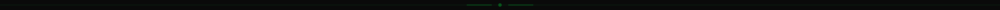
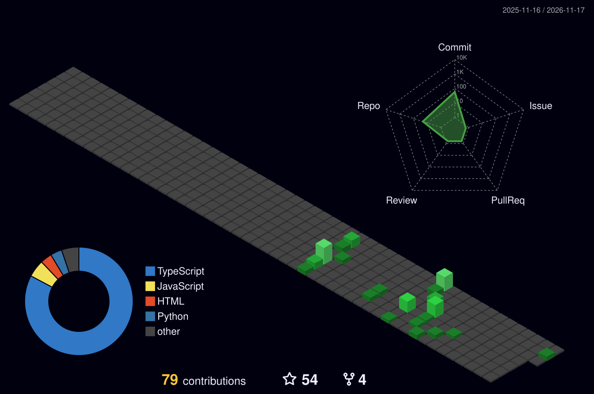

<div align="center">

<!-- ═══════════════════════════════════════════════════════════════ -->
<!-- ▸ HERO DASHBOARD BANNER                                        -->
<!-- ═══════════════════════════════════════════════════════════════ -->


<br/>

<!-- ═══════════════════════════════════════════════════════════════ -->
<!-- ▸ PORTRAIT + IDENTITY                                          -->
<!-- ═══════════════════════════════════════════════════════════════ -->
<table>
<tr>
<td align="center" width="280">

<br/><br/>
<a href="https://github.com/saivenkatsumanth9-stack">

</a>
</td>
<td align="left" width="600">

```
╔══════════════════════════════════════════════════╗
║  PEDDI SAI VENKAT SUMANTH                        ║
║  ───────────────────────────────                 ║
║  AI Engineer | Software Developer                ║
║  Full-Stack Builder | Cloud & ML Explorer        ║
║                                                  ║
║  B.Tech CSE | 2027                               ║
║  Nalla Narasimha Reddy Group of Institutions     ║
║  Hyderabad, Telangana                            ║
║                                                  ║
║  > I build practical software systems across     ║
║    AI, machine learning, full-stack development, ║
║    cloud computing and data-driven applications. ║
╚══════════════════════════════════════════════════╝
```

</td>
</tr>
</table>

<!-- ▸ TYPING TERMINAL -->
<a href="https://github.com/saivenkatsumanth9-stack">

</a>

<br/>

<!-- ▸ ACTION BUTTONS -->
<a href="https://linkedin.com/in/saivenkatsumanth"></a>&nbsp;
<a href="https://github.com/saivenkatsumanth9-stack"></a>&nbsp;
<a href="mailto:saivenkatsumanth9@gmail.com"></a>&nbsp;
<a href="https://psvs-portfolio.vercel.app/"></a>&nbsp;
<a href="https://benefit-navigator-main.vercel.app"></a>

<br/><br/>

</div>



<!-- ═══════════════════════════════════════════════════════════════ -->
<!-- ▸ CURRENTLY BUILDING                                           -->
<!-- ═══════════════════════════════════════════════════════════════ -->

### `▸ CURRENTLY_BUILDING`

<div align="center">

<table>
<tr>
<td align="center" width="160">
<br/>
<sub><b>AI & ML Systems</b></sub><br/>
<sub>Neural Networks · RAG</sub>
</td>
<td align="center" width="160">
<br/>
<sub><b>Web Applications</b></sub><br/>
<sub>React · Node · FastAPI</sub>
</td>
<td align="center" width="160">
<br/>
<sub><b>AWS & Cloud</b></sub><br/>
<sub>Lambda · DynamoDB · S3</sub>
</td>
<td align="center" width="160">
<br/>
<sub><b>Data & Analytics</b></sub><br/>
<sub>Pandas · SQL · ETL</sub>
</td>
<td align="center" width="160">
<br/>
<sub><b>System Design</b></sub><br/>
<sub>80+ LeetCode Solved</sub>
</td>
<td align="center" width="160">
<br/>
<sub><b>Game Development</b></sub><br/>
<sub>Unity · C#</sub>
</td>
</tr>
</table>

</div>


<!-- ═══════════════════════════════════════════════════════════════ -->
<!-- ▸ TECH STACK + ACTIVITY DASHBOARD                              -->
<!-- ═══════════════════════════════════════════════════════════════ -->

### `▸ TECH_ECOSYSTEM & ACTIVITY`

<div align="center">

</div>

<br/>

<div align="center">

<table>
<tr>
<td align="center"><b>LANGUAGES</b></td>
<td align="center"><b>FRONTEND</b></td>
<td align="center"><b>BACKEND</b></td>
<td align="center"><b>AI / ML</b></td>
<td align="center"><b>CLOUD & TOOLS</b></td>
</tr>
<tr>
<td align="center">


</td>
<td align="center">


</td>
<td align="center">


</td>
<td align="center">


</td>
<td align="center">


</td>
</tr>
</table>

</div>


<!-- ═══════════════════════════════════════════════════════════════ -->
<!-- ▸ FEATURED PROJECTS                                            -->
<!-- ═══════════════════════════════════════════════════════════════ -->

### `▸ FEATURED_PROJECTS`

<div align="center">

<table>
<tr>
<td width="50%" valign="top">

**`01` BENEFITX** `▸ LIVE`
> Government benefit navigator with AI-powered eligibility matching.
> React 19 · TanStack Start · Supabase · Vercel

[](https://benefit-navigator-main.vercel.app)
[](https://github.com/saivenkatsumanth9-stack/BenefitNavigator)

</td>
<td width="50%" valign="top">

**`02` HANDSCAPE GAME** `▸ 3D`
> MediaPipe-powered 3D escape room with hand gesture controls.
> Three.js · MediaPipe · React · WebGL

[](https://github.com/saivenkatsumanth9-stack/HandScapeGame)

</td>
</tr>
<tr>
<td width="50%" valign="top">

**`03` AGENTIC RESEARCH AGENT** `▸ AI`
> ReAct-pattern autonomous research agent with tool use and reasoning.
> Python · FastAPI · LangChain · ReAct

[](https://github.com/saivenkatsumanth9-stack/Agentic-Research-Agent)

</td>
<td width="50%" valign="top">

**`04` BODY IQ** `▸ HEALTH`
> Personalized fitness, nutrition and health optimization platform.
> Python · ML · BMI/BMR/TDEE · AI Assistant

[](https://github.com/saivenkatsumanth9-stack)

</td>
</tr>
<tr>
<td width="50%" valign="top">

**`05` STUDYBUDDY AI** `▸ RAG`
> AI study companion with RAG-powered document Q&A.
> Python · RAG · Vector DB · FastAPI

[](https://github.com/saivenkatsumanth9-stack/StudyBuddy)

</td>
<td width="50%" valign="top">

**`06` LAST STANDING THIEF** `▸ GAME`
> 2D stealth game built with Unity and C#.
> Unity · C# · 2D Game Design · Physics

[](https://github.com/saivenkatsumanth9-stack/Last-Standing-thief)

</td>
</tr>
</table>

</div>


<!-- ═══════════════════════════════════════════════════════════════ -->
<!-- ▸ GITHUB ANALYTICS                                             -->
<!-- ═══════════════════════════════════════════════════════════════ -->

### `▸ GIT_ANALYTICS`

<div align="center">

<!-- Trophies -->


<br/><br/>

<!-- Stats Row -->


<br/><br/>

<!-- Languages -->


<br/><br/>

<!-- Activity Graph -->


<br/><br/>

<!-- 3D Contribution -->


<br/><br/>

<!-- Contribution Snake -->
<picture>
  <source media="(prefers-color-scheme: dark)" srcset="https://raw.githubusercontent.com/saivenkatsumanth9-stack/saivenkatsumanth9-stack/output/github-snake-dark.svg"/>
  
</picture>

</div>


<!-- ═══════════════════════════════════════════════════════════════ -->
<!-- ▸ CERTIFICATIONS                                               -->
<!-- ═══════════════════════════════════════════════════════════════ -->

### `▸ CERTIFICATIONS_LOG`

<div align="center">

```
┌────────────────────────────────────────────────────────────────────┐
│  ✓  MongoDB Advanced Database Administration                      │
│  ✓  ServiceNow Certified Application Developer (CAD)              │
│  ✓  AWS DevOps & AI Foundations                                   │
│  ✓  Google AI Essentials                                          │
│  ✓  Google Prompting Essentials                                   │
│  ✓  Quantum Computing Foundations                                 │
│  ✓  Unity 6 & C# Game Development                                │
│  ✓  Data Analytics Professional Certificate                       │
│  ✓  80+ LeetCode Problems Solved                                  │
└────────────────────────────────────────────────────────────────────┘
```

</div>


<!-- ═══════════════════════════════════════════════════════════════ -->
<!-- ▸ CONNECT                                                      -->
<!-- ═══════════════════════════════════════════════════════════════ -->

### `▸ CONNECT`

<div align="center">

<a href="https://linkedin.com/in/saivenkatsumanth"></a>&nbsp;
<a href="https://github.com/saivenkatsumanth9-stack"></a>&nbsp;
<a href="mailto:saivenkatsumanth9@gmail.com"></a>&nbsp;
<a href="https://psvs-portfolio.vercel.app/"></a>

<br/><br/>

<!-- Metrics -->


<br/><br/>

</div>

<!-- ═══════════════════════════════════════════════════════════════ -->
<!-- ▸ FOOTER                                                       -->
<!-- ═══════════════════════════════════════════════════════════════ -->


<div align="center">


<br/>

<sub>⚡ Built with discipline, designed with intent</sub>

</div>
